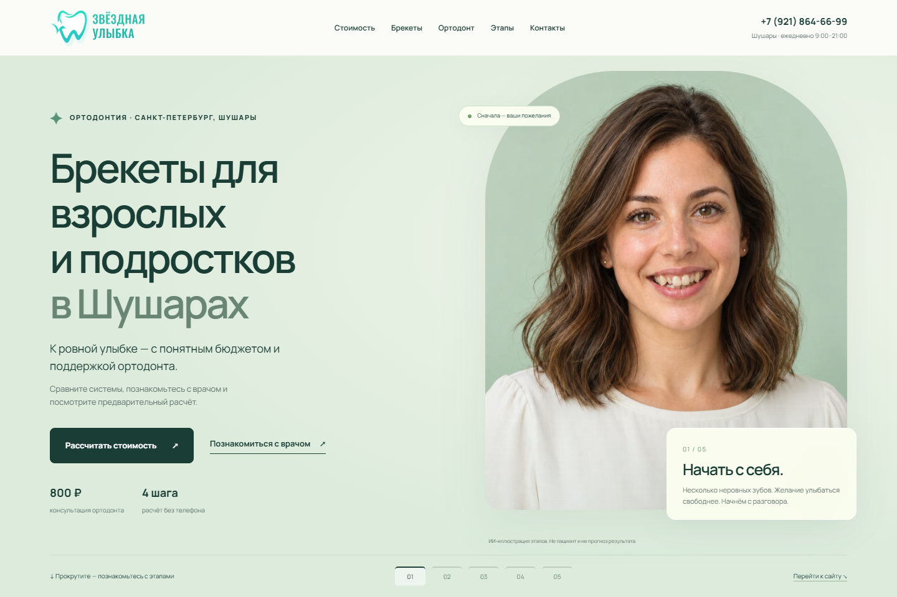
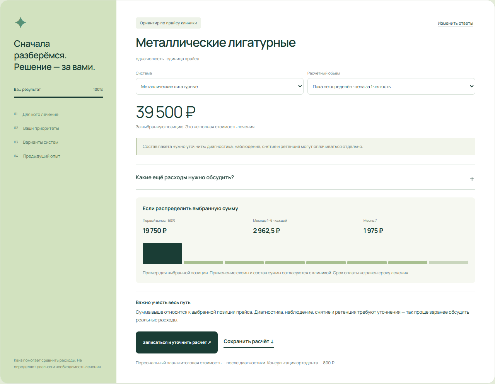

# Звёздная Улыбка — лендинг по брекетам

Пример адаптивного лендинга стоматологии в Шушарах. Проект объединяет информацию об ортодонтическом лечении, знакомство с врачом и предварительное сравнение расходов.



## Что сделано

- Пять сцен первого экрана: одна иллюстративная героиня на этапах лечения; управление прокруткой и кнопками.
- Квиз с тремя сценариями: взрослые 18–24 лет, взрослые 25 лет и старше, родители подростков.
- Сравнение металлических и керамических систем.
- Калькулятор опубликованных позиций прайса, смена системы и расчётного объёма.
- График: 50% в начале, шесть платежей по 15% первоначального остатка и последний — 10%.
- Сохранение предварительного расчёта в текстовый файл.
- Форма записи с проверкой номера и согласия.
- Интерактивная схема изменения положения зубов, управление ползунком и вертикальной линией.
- Адаптивная вёрстка, клавиатурная навигация, режим уменьшения движения, локальные шрифты.

## Расчёт

Калькулятор сравнивает позиции прайса, а не назначает лечение и не выдаёт окончательную смету. Услуги не складываются автоматически, пока состав пакета не подтверждён. Цены и условия оплаты требуют актуализации перед использованием. Иллюстрации созданы с ИИ, не являются фотографиями пациентов или прогнозом результата.



## Открыть локально

Откройте index.html в корне проекта либо запустите: 

```sh
node scripts/preview.cjs
```

Адрес: http://127.0.0.1:4173/ . Рабочие файлы находятся в dist/. Канал доставки обращений настраивается под конкретный проект.

## Структура

- dist/index.html — разметка и тексты.
- dist/styles.css и refinements.css — оформление и адаптация.
- dist/app.js — сцены, квиз, форма и интерактивная модель.
- dist/calc.js — цены и расчёт платежей.
- dist/assets/ — фотографии, иллюстрации и шрифты.
- img/ — скриншоты.

Факты и публичные материалы клиники взяты с https://clinic-bk.ru/ . Публикация примера не означает одобрение клиникой или измеренный рост обращений.
